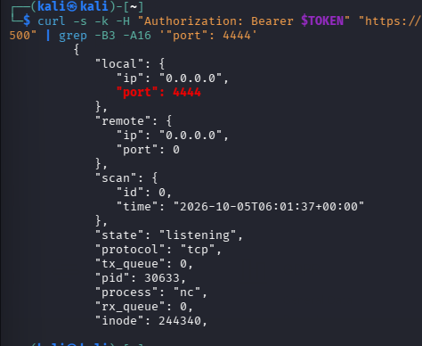

# الرؤية على الجهاز (Endpoint Visibility) باستخدام Wazuh Syscollector

## الهدف
إثبات أن Wazuh Syscollector يقدر يكتشف بورتاً مفتوحاً جديداً ويحدد البرنامج اللي فتحه.

## البيئة
- Kali Linux (مختبر منزلي)
- Wazuh Manager (الجهاز رقم 000)
- وحدة Syscollector وواجهة Wazuh API

## الخطوات
1. قرأت البورتات المفتوحة من Wazuh API: `/syscollector/000/ports`
2. فتحت بورتاً تجريبياً بالأمر `nc -lvnp 4444`
3. أعدت تشغيل `wazuh-manager` لإجبار جرد جديد
4. استعلمت من الـ API مرة ثانية وبحثت عن البورت 4444

## النتيجة والدليل
ظهر البورت 4444 بحالة `listening`، والعملية `nc` (PID 30633)، على العنوان `0.0.0.0`.

## التحليل
- ظهور `nc` على بورت غير معروف قد يدل على باب خلفي (Backdoor) أو Reverse Shell.
- **القيود:** الجرد يتم بشكل دوري، فالبورت اللي ينفتح وينقفل بين فحصين قد لا ينلقط. والجرد يبيّن **ماذا** مفتوح، ولا يبيّن **من** فتحه.

## الدروس المستفادة
- أول مرة أظهر `grep` اسم عملية غلط، لأن السطر كان من البلوك السابق، فتأكدت مرة ثانية قبل ما أكتب النتيجة.
- التوكن الخاص بالـ API ينتهي بسرعة، وخيار `curl -s` أخفى رسالة الخطأ.

---

# Endpoint Visibility with Wazuh Syscollector

## Objective
Show that Wazuh Syscollector can find a new open port and name the program that opened it.

## Environment
- Kali Linux (home lab)
- Wazuh Manager (agent 000)
- Wazuh API and Syscollector module

## Steps
1. Read the open ports from the Wazuh API: `/syscollector/000/ports`
2. Opened a test port with `nc -lvnp 4444`
3. Restarted `wazuh-manager` to force a new inventory scan
4. Asked the API again and searched for port 4444

## Result and Evidence
Port 4444 appeared with state `listening`, process `nc` (PID 30633), on `0.0.0.0`.

## Analysis
- `nc` on an unknown port can be a sign of a backdoor or reverse shell.
- Limits: the inventory runs on a schedule, so a port that opens and closes between two scans can be missed. It shows **what** is open, not **who** opened it.

## Lessons Learned
- My first `grep` showed the wrong process name because the line was from the previous block. I checked again before writing the result.
- The API token expires quickly, and `curl -s` hid the error message.
