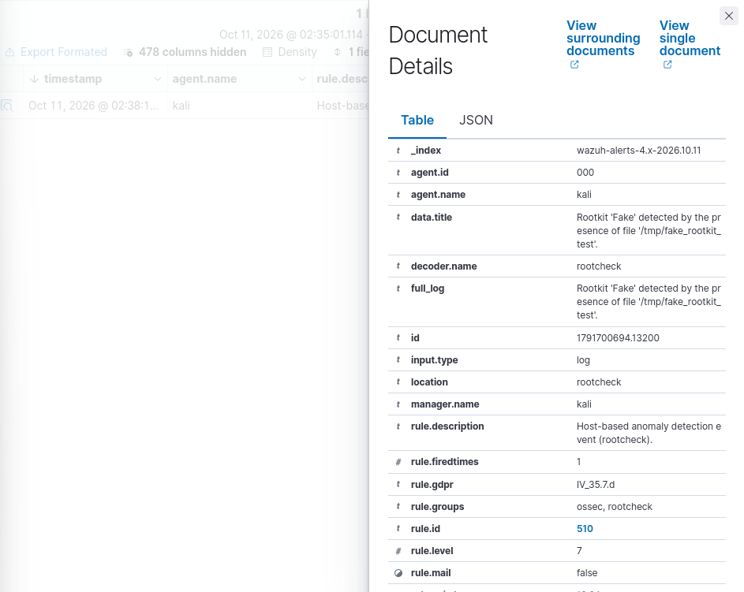

# كشف الـ Rootkit باستخدام Wazuh Rootcheck

## الهدف
إثبات أن وحدة rootcheck في Wazuh تقدر تكتشف ملفاً من قائمتها المعروفة للـ Rootkits، باستخدام ملف وهمي آمن.

## البيئة
- Kali Linux (مختبر منزلي)
- Wazuh Manager
- وحدة Rootcheck (تفحص كل 12 ساعة، `frequency` = 43200 ثانية)

## الإعدادات
- `<disabled>no</disabled>` تعني أن rootcheck **مفعّل**
- القوائم المعروفة: `etc/rootcheck/rootkit_files.txt` و`etc/rootcheck/rootkit_trojans.txt`

## الخطوات
1. أخذت نسخة احتياطية من `rootkit_files.txt`
2. أنشأت ملفاً وهمياً: `/tmp/fake_rootkit_test`
3. أضفت سطراً وهمياً لهذا الملف في `rootkit_files.txt`
4. أعدت تشغيل `wazuh-manager` لبدء الفحص
5. فحصت التنبيه في لوحة Wazuh
6. نظّفت: استرجعت القائمة وحذفت الملف الوهمي
   - أمر `grep -c "fake"` على القائمة رجع `0`
   - أمر `ls /tmp/fake_rootkit_test` رجع `No such file or directory`

## النتيجة والدليل
- القاعدة `510`، المستوى `7`، الـ decoder هو `rootcheck`
- `data.title`: انكشف Rootkit باسم 'Fake' بسبب وجود الملف '/tmp/fake_rootkit_test'

## التحليل
- ظهرت **9 تنبيهات** من القاعدة 510، وواحد فقط يخص تجربتي. ما وصفت الثمانية الباقية بأنها "وهمية" لأنه ما عندي دليل.
- تجربتي أثبتت أن Wazuh يكتشف ملفات من **قائمة معروفة**، وأنا من أضاف السطر. وما أثبتت أنه يقدر يكتشف Rootkit جديداً غير معروف.
- الفحص كل 12 ساعة، فممكن يبقى Rootkit مخفياً حتى 12 ساعة (بدون احتساب إعادة التشغيل).

## الدروس المستفادة
- أفتح كل تنبيه وأقرأ تفاصيله قبل ما أحكم.
- أتأكد أول، وبعدين أصعّد ومعي الدليل.
- أرجّع النظام لوضعه بعد التجربة، وأثبت ذلك بأمر.

---

# Rootkit Detection with Wazuh Rootcheck

## Objective
Show that Wazuh rootcheck can find a file from its known rootkit list. I used a safe, fake file.

## Environment
- Kali Linux (home lab)
- Wazuh Manager
- Rootcheck module (scans every 12 hours, `frequency` = 43200 seconds)

## Configuration
- `<disabled>no</disabled>` means rootcheck is **enabled**
- Known lists: `etc/rootcheck/rootkit_files.txt` and `etc/rootcheck/rootkit_trojans.txt`

## Steps
1. Made a backup of `rootkit_files.txt`
2. Created a fake file: `/tmp/fake_rootkit_test`
3. Added a fake entry for this file to `rootkit_files.txt`
4. Restarted `wazuh-manager` to start a scan
5. Checked the alert in the Wazuh dashboard
6. Cleaned up: restored the list and deleted the fake file
   - `grep -c "fake"` on the list returned `0`
   - `ls /tmp/fake_rootkit_test` returned `No such file or directory`

## Result and Evidence
- Rule `510`, level `7`, decoder `rootcheck`
- `data.title`: Rootkit 'Fake' detected by the presence of file '/tmp/fake_rootkit_test'

## Analysis
- The scan showed **9 alerts** from rule 510. Only one was from my test. I did not call the other 8 "fake", because I had no proof.
- My test showed that Wazuh finds files from a **known list**. I added the entry myself. It did **not** show that Wazuh can find a new, unknown rootkit.
- The scan runs every 12 hours, so a rootkit could stay hidden for up to 12 hours (not counting a restart).

## Lessons Learned
- Open each alert and read the details before you decide.
- Check first, then escalate with evidence.
- Restore the system after a test, and prove it with a command.
