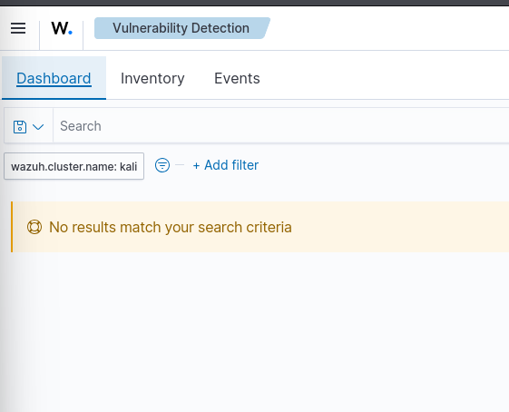

# كشف الثغرات باستخدام Wazuh: حالة نتيجة فارغة

## الهدف
التحقق هل وحدة كشف الثغرات في Wazuh تكتشف برامج ضعيفة على جهاز مختبري، ولما طلعت النتيجة فارغة، معرفة السبب.

## البيئة
- Kali Linux 2026.2 (مختبر منزلي)
- Wazuh Manager (الجهاز 000) وWazuh Indexer وWazuh API

## الإعدادات
- `<enabled>yes</enabled>`: الوحدة مفعّلة
- `<feed-update-interval>60m</feed-update-interval>`: قاعدة الثغرات تتحدث كل 60 دقيقة

## النتيجة
صفحة كشف الثغرات في اللوحة أظهرت: "No results match your search criteria".

## كيف تحققت (خطوة بخطوة)
| الفحص | النتيجة |
|---|---|
| سجل Wazuh (`ossec.log`) | الماسح يشتغل بعد كل إعادة تشغيل، وظهرت تحذيرات "انقطاع التنزيل" وقت إعادة التشغيل |
| حجم `/var/ossec/queue/vd_updater/` | 2.6 جيجابايت، يعني قاعدة الثغرات نزلت |
| استعلام الـ Indexer عن الثغرات | `count: 0` |
| Wazuh API: حزم الجهاز 000 | 3688 حزمة (Syscollector يعمل) |
| Wazuh API: اسم النظام | `Kali GNU/Linux`، الإصدار `2026.2` |

## التحليل
- الوحدة مفعّلة، والقاعدة نزلت، وقائمة الحزم كاملة. فالسبب الأرجح أن **Kali ليس ضمن الأنظمة المدعومة** في إصدار Wazuh عندي (4.9).
- **لم أستطع تأكيد ذلك.** ما لقيت رسالة صريحة في السجل تقول "نظام غير مدعوم"، والتأكد يحتاج رفع مستوى السجل (debug).
- إعداد قديم من توثيق Wazuh 4.3 إلى 4.7 (`<os allow>`) لا ينطبق على الإعداد الجديد `<vulnerability-detection>`.

## الدروس المستفادة
- **عدم وجود نتائج لا يعني أن النظام آمن.** قد يعني أن الأداة لا تقدر تفحص هذا النظام.
- الفحص المنهجي (السجل، قاعدة البيانات، البيانات المدخلة، نوع النظام) أفضل من الانتظار أو التخمين.
- أكتب بوضوح ما تحققت منه وما لم أتحقق منه.
- أقرأ رسالة الخطأ: `Invalid token` كانت تعني أن متغير التوكن فيه نص خطأ وليس توكن.

---

# Vulnerability Detection with Wazuh: An Empty Result

## Objective
Check if Wazuh Vulnerability Detection finds weak software on my lab machine. When the result was empty, find out why.

## Environment
- Kali Linux 2026.2 (home lab)
- Wazuh Manager (agent 000), Wazuh Indexer, Wazuh API

## Configuration
- `<enabled>yes</enabled>`: the module is on
- `<feed-update-interval>60m</feed-update-interval>`: the vulnerability database updates every 60 minutes

## Result
The Vulnerability Detection page in the dashboard showed: "No results match your search criteria".

## How I checked (step by step)
| Check | Result |
|---|---|
| Wazuh log (`ossec.log`) | The scanner starts after each restart. Some "download interrupted" warnings appeared during restarts |
| Size of `/var/ossec/queue/vd_updater/` | 2.6 GB, so the vulnerability database was downloaded |
| Indexer query for vulnerabilities | `count: 0` |
| Wazuh API: packages for agent 000 | 3,688 packages (Syscollector works) |
| Wazuh API: OS name | `Kali GNU/Linux`, version `2026.2` |

## Analysis
- The module is on, the database is downloaded, and the package list is complete. So the most likely reason is that **Kali is not in the list of supported systems** for my Wazuh version (4.9).
- **I could not confirm this.** I found no clear log message that says "unsupported OS". Confirming it needs a higher log level (debug).
- An old setting from the Wazuh 4.3–4.7 docs (`<os allow>`) does not apply to the new `<vulnerability-detection>` setting.

## Lessons Learned
- **No result does not mean the system is safe.** It can mean the tool cannot scan this system.
- A step-by-step check (logs, database, input data, system type) is better than waiting or guessing.
- I write clearly what I checked and what I did not check.
- Read the error message: `Invalid token` meant my token variable had an error text, not a token.
